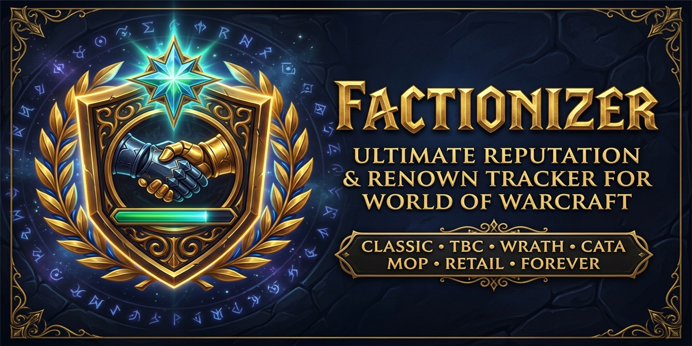

  

  # Factionizer (v7.0.0 — Ace3 Edition)

  **The Ultimate Multi-Version Reputation, Renown, Paragon & Friendship Companion for World of Warcraft!**

  
  
  
  
  
  
  
  

---

**Factionizer** is the ultimate Reputation, Renown, Paragon, and Friendship management companion for World of Warcraft — showing you every single quest, dungeon, raid, mob, item turn-in, tabard, daily, and world quest available to reach **Exalted** or **Maximum Renown**, complete with bag/bank/quest-log reputation previews and visual chat progress bars.

---

## 🎮 Supported WoW Versions

- **Retail (Midnight `12.x` & The War Within `11.2.x`)**
- **Mists of Pandaria Classic (`5.5.x`)**
- **Cataclysm Classic (`4.4.x`)**
- **Wrath of the Lich King Classic (`3.4.x` / `3.8.x`)**
- **The Burning Crusade Classic Anniversary (`2.5.x`)**
- **Classic Era (`1.15.x`) & Classic Forever (`1.60.x` / `16001`)**

---

## ✨ Key Features

- **📊 Modern Dark-Gold Reputation Detail Frame**:
  - Displays exact reputation needed for the next standing and all the way to **Exalted** / **Maximum Renown**.
  - Live **StatusBar + Preview Bar** (`LibSharedMedia-3.0`) showing pending reputation gains from items in your bags, bank, and completed quests in your quest log (`+preview`).
  - Interactive filter pills (**Quests**, **Instances**, **Mobs**, **Items**, **General**) with glowing status indicators and **real-time search**.
  - Color-coded source badges (`[Q]` Quests, `[D]` Dungeons, `[M]` Mobs, `[I]` Items, `[G]` General/Tabards) and right-click quest exclusion.
  - **Dock / Detach Mode** (`LibWindow-1.1`), persistent coordinates, `Ctrl + MouseWheel` frame scaling, and live **UI Font Size (`10pt – 18pt`)** controls (`A-` | `13pt` | `A+`).
- **🌍 Complete Cross-Expansion Database (Classic → Midnight 12.x)**:
  - **Classic / SoD / Classic Forever (`1.x` / `16001`)**: Capital cities, Runecloth turn-ins, Alterac Valley / Warsong / Arathi, Steamwheedle Cartel, Argent Dawn, Timbermaw Hold, Thorium Brotherhood, Cenarion Circle, Brood of Nozdormu, Zandalar Tribe, Hydraxian Waterlords, Shen'dralar, Wintersaber Trainers, Darkmoon Faire, SoD Supply Factions, and Classic Forever custom factions (*The High Order*, *Nightclaw Druids*, *Windshapers*, *Barkskin Burrow*, *Bolder'ok Clan*, *Brotherhood of the Horse*, *Powderfuse*, *Cenarion Scouts*, *The Watchers*, etc.).
  - **The Burning Crusade → Warlords of Draenor (`2.x – 6.x`)**: All dungeon tabard championing, Outland/Northrend/Cataclysm/Pandaria/Draenor factions, Tillers & Anglers friendships, and Timewalking Commendations.
  - **Legion → Midnight (`7.x – 12.x`)**: World Quests, Elite World Quests, Emissary Quests, Covenant Callings, Contracts, Bountiful Delves, Special Assignments, Major Renown factions, Paragon caches, and Undermine Cartels.
- **🧭 Interactive Minimap & DataBroker Tooltip (`LibQTip-1.0`)**:
  - 5-column interactive tooltip (*Faction*, *Standing*, *Current Reputation* with embedded **StatusBar** progress bars, *Missing*, *Session Gain*).
  - **Left-Click** any faction row to open its Reputation Detail Guide; **Right-Click** to set it as your watched faction bar.
  - Native **Blizzard Addon Compartment** and **`LibDBIcon-1.0`** support.
- **🔔 Visual Chat Progress Bars, Notifications & Sharing (`LibSink-2.0` & `LibDeflate`)**:
  - Prints a compact visual reputation progress line in chat on every reputation gain (e.g. `Der Hohe Orden: +10 (0.2%) - 40% bis Wohlwollend: [|||||||||||||||]`) alongside detailed remaining reputation & repeat counts.
  - Route reputation notifications to Chat, Floating Combat Text, UIErrorsFrame, RaidWarning, MSBT, Parrot, or SCT.
  - Export/Import compressed profile & quest exclusion strings (`!FIZ1!...`) and sync suppressed quests across Guild, Party, or Raid (`AceComm-3.0`).

---

## ⌨️ Slash Commands

| Command | Description |
| :--- | :--- |
| `/fz` or `/factionizer` | Open the standalone **Factionizer Options** window |
| `/fz status` | Display current configuration status in chat |
| `/fz list [1-8 \| standing]` | List factions sorted by standing and missing reputation |
| `/fz enable\|disable\|toggle <option>` | Toggle `mobs`, `quests`, `instances`, `items`, `general`, `missing`, `details`, `chat`, `suppress`, `preview`, `bar`, or `all` |
| `/fz about` | Show version and author details |
| `/fz help` | Show command overview |

---

## 👥 Credits & License

- **Authors**: Urbin (Original Author), Millán-Aszune, **gOOvER** (v7.0.0 Ace3 & Modern UI Overhaul)
- **License**: [GNU General Public License v2.0 (GPL-2.0)](LICENSE)
- **Support Development**: [donate.goover.dev](https://donate.goover.dev) • [Ko-fi](https://ko-fi.com/oldnoob) • [Buy Me a Coffee](https://buymeacoffee.com/goover)
