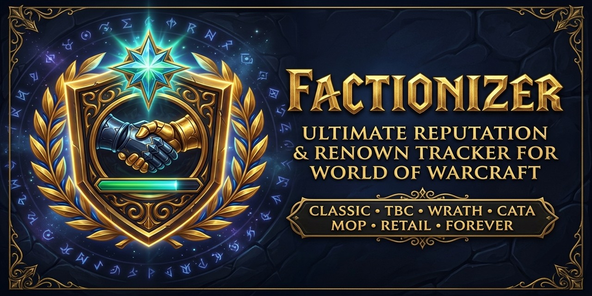

  

<h1 align="center">Factionizer (v7.0.0 — Ace3 Edition)</h1>

  <strong>The Ultimate Multi-Version Reputation, Renown, Paragon &amp; Friendship Companion for World of Warcraft</strong> 
  <em>Supporting Retail (12.x Midnight &amp; 11.x The War Within), MoP Classic, Cataclysm Classic, Wrath/Titan Classic, TBC Anniversary, Classic Era &amp; Classic Forever</em>

---

## ✨ Key Features

- **📊 Modern Dark-Gold Reputation Detail Frame**:
  - Displays exact reputation needed for the next standing and all the way to **Exalted** / **Maximum Renown**.
  - Live **StatusBar + Preview Bar** (`LibSharedMedia-3.0`) showing pending reputation gains from items in your bags, bank, and completed quests in your quest log (`+preview`).
  - Interactive filter pills (**Quests**, **Instances**, **Mobs**, **Items**, **General**) with glowing status indicators and **real-time search**.
  - Color-coded source badges (`[Q]` Quests, `[D]` Dungeons, `[M]` Mobs, `[I]` Items, `[G]` General/Tabards) and right-click quest exclusion.
  - **Dock / Detach Mode** (`LibWindow-1.1`), persistent coordinates, `Ctrl + MouseWheel` frame scaling, and live **UI Font Size (`10pt – 18pt`)** controls (`A-` | `13pt` | `A+`).
- **🌍 Complete Cross-Expansion Database (Classic → Midnight 12.x)**:
  - **Classic / SoD / Classic Forever (`1.x` / `16001`)**: Capital cities, Runecloth turn-ins, Alterac Valley / Warsong / Arathi, Steamwheedle Cartel, Argent Dawn, Timbermaw Hold, Thorium Brotherhood, Cenarion Circle, Brood of Nozdormu, Zandalar Tribe, Hydraxian Waterlords, Shen'dralar, Wintersaber Trainers, Darkmoon Faire, SoD Supply Factions, and Classic Forever custom factions (*The High Order*, *Nightclaw Druids*, *Windshapers*, *Barkskin Burrow*, *Bolder'ok Clan*, *Brotherhood of the Horse*, *Powderfuse*, *Cenarion Scouts*, *The Watchers*, etc.).
  - **The Burning Crusade → Warlords of Draenor (`2.x – 6.x`)**: All dungeon tabard championing, Outland/Northrend/Cataclysm/Pandaria/Draenor factions, Tillers & Anglers friendships, and Timewalking Commendations.
  - **Legion → Midnight (`7.x – 12.x`)**: World Quests, Elite World Quests, Emissary Quests, Covenant Callings, Contracts, Bountiful Delves, Special Assignments, Major Renown factions, Paragon caches, and Undermine Cartels.
- **🧭 Interactive Minimap & DataBroker Tooltip (`LibQTip-1.0`)**:
  - 5-column interactive tooltip (*Faction*, *Standing*, *Current Reputation* with embedded **StatusBar** progress bars, *Missing*, *Session Gain*).
  - **Left-Click** any faction row to open its Reputation Detail Guide; **Right-Click** to set it as your watched faction bar.
  - Native **Blizzard Addon Compartment** and **`LibDBIcon-1.0`** support.
- **🔔 Customizable Notifications & Sharing (`LibSink-2.0` & `LibDeflate`)**:
  - Route reputation gains to Chat, Floating Combat Text, UIErrorsFrame, RaidWarning, MSBT, Parrot, or SCT, including remaining reputation and how many repeats are needed.
  - Export/Import compressed profile & quest exclusion strings (`!FIZ1!...`) and sync suppressed quests across Guild, Party, or Raid (`AceComm-3.0`).

---

## ⌨️ Slash Commands

| Command | Description |
| :--- | :--- |
| `/fz` or `/factionizer` | Open the standalone **Factionizer Options** window |
| `/fz status` | Display current configuration status in chat |
| `/fz list [1-8 \| standing]` | List factions sorted by standing and missing reputation |
| `/fz enable\|disable\|toggle <option>` | Toggle `mobs`, `quests`, `instances`, `items`, `general`, `missing`, `details`, `chat`, `suppress`, `preview`, `bar`, or `all` |
| `/fz about` | Show version and author details |
| `/fz help` | Show command overview |

---

## 👥 Credits & License

- **Authors**: Urbin (Original Author), Millán-Aszune, **gOOvER** (v7.0.0 Ace3 & Modern UI Overhaul)
- **Support Development**: [donate.goover.dev](https://donate.goover.dev) • [Ko-fi](https://ko-fi.com/oldnoob) • [Buy Me a Coffee](https://buymeacoffee.com/goover)
